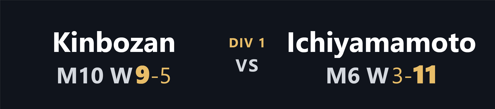
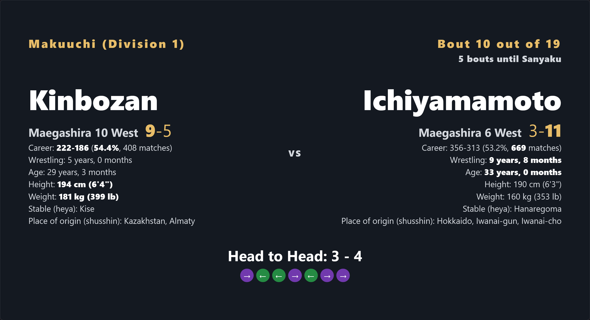
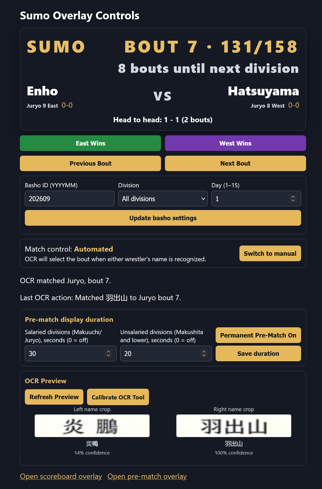
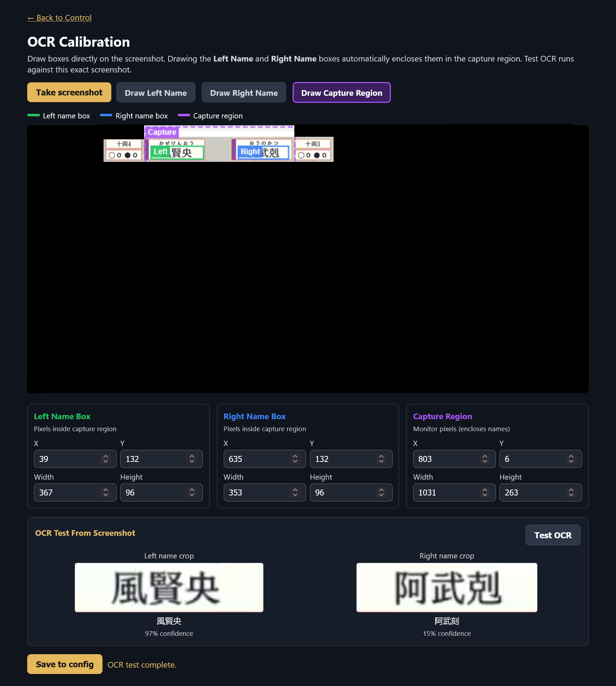

# Sumo Broadcast Overlay

This program creates a scoreboard overlay for sumo broadcast, so you can see the English wrestler names, plus a prematch overlay that shows head to head stats. This can be used for streaming, recording, or watching by yourself.
It uses [OCR](#ocr-bout-detection) to recognize wrestler names on the broadcast to determine what match you are on, or you can control it manually. We download a basho's bout lists and head to head stats from [sumo-api.com](https://sumo-api.com) (thank you sumo-api, this project wouldn't be possible without it).

1. **Scoreboard overlay** — a persistent scoreboard overlay with the current division, wrestler names, their records before this bout, and abbreviated ranks. 

    

2. **Pre-match overlay** — a larger matchup card with ranks, pre-bout records, and head-to-head (H2H) wins. When enabled, it appears when a bout starts and automatically hides after the configured number of seconds. This timer works the same in manual and automated OCR modes. Can be turned on/off manually.

    

3. **Control Website** — a web interface to control bouts, view the current match, and adjust settings.

    

4. **Calibration** — a tool to help you adjust the OCR capture regions and name boxes for accurate recognition of wrestler names on the broadcast.

    

Settings are read from `config.yaml`. The app creates the file from built-in defaults when the app starts. The app watches the file and reloads valid changes while it is running. Optional OCR can recognize Japanese names on the scoreboard and select the uniquely matching scheduled bout automatically. OCR uses the exact Japanese-to-English lookup from [sumo-api.com](https://sumo-api.com)

## Requirements

- The zip of the project with the executable included.
- An internet connection to fetch data from sumo-api.com.
- OBS Studio or some other streaming software, if you want to stream the overlays.

The base app uses CPU-only Python packages. OCR is optional and requires EasyOCR, PyTorch, MSS, and NumPy; a GPU is not required.

## Control page and addresses

With the app running, open:

- Control page: <http://127.0.0.1:5000/control>
- Scoreboard overlay: <http://127.0.0.1:5000/scoreboard>
- Slim half-width scoreboard: <http://127.0.0.1:5000/scoreboard/slimhalf>
- Slim full-width scoreboard: <http://127.0.0.1:5000/scoreboard/slimfull>
- Pre-match overlay: <http://127.0.0.1:5000/prematch>
- OCR calibration tool: <http://127.0.0.1:5000/calibrate>

By default, the server is available only on the computer running SumoOverlay.
To use OCR on the computer displaying the sumo stream while OBS runs on another
computer, set `server.allow_lan_access` to `true` in `config.yaml` and restart
SumoOverlay. The server will listen on the network interfaces; use the
SumoOverlay computer's LAN IP address in the other computer's OBS Browser
Source, for example `http://192.168.1.25:5000/scoreboard`. Use the same address
for `/prematch` or `/control` as needed. Allow the configured port through the
host computer's firewall if prompted. This exposes the app, including its
control page and API, to devices on the LAN, so enable it only on a trusted
network and do not forward the port to the internet.

## Use a packaged Windows release

Extract the entire `SumoOverlay.zip` or `SumoOverlay-NoOCR.zip` to a folder, then run `SumoOverlay.exe` or `SumoOverlay-NoOCR.exe` from that folder.
Keep the console window open while using the app, and open
<http://127.0.0.1:5000/control> in your browser.

The OCR release starts with automated OCR control. EasyOCR downloads its
Japanese recognition models the first time OCR is used. The no-OCR release starts in manual mode and does not
include OCR. In either release, keep the full folder together; the editable
`config.yaml` controls the server and overlay settings.
The first launch creates the config file automatically. When you update
an existing release, keep your `config.yaml`: startup fills in settings
that are new in the release without replacing your existing values. Only
settings explicitly marked as deprecated by the app are removed.

On the control page, use **Previous Bout** and **Next Bout** for manual synchronization. After a bout finishes, optionally choose **East Wins** or **West Wins** to show that result in the Control page and overlays. This temporarily adds one win to the selected wrestler and one loss to the other wrestler's displayed record.
Use **Basho ID**, **Division**, and **Day** on the control page to change the tournament data. The updated data settings are saved to the configuration file and the schedule reloads. If using OCR, select **All divisions**; choosing one division limits OCR matching to bouts in that division. Set match control to **Manual** for button-driven selection or **Automated** for OCR selection.

For the pre-match overlay, use the separate **Salaried divisions** and **Unsalaried divisions** duration fields and click **Save duration** to choose how long the pre-match card appears after a bout change. Set either value to `0` to disable timed auto-show for that group. **Show pre-match until I turn it off** pins the card on-screen until you press **Hide pre-match now**; manual display remains available even when timed auto-show is disabled.

### Calibrate OCR

The scanner captures one rectangle of the monitor (`ocr.capture_regions.scoresheet`), then crops the left and right wrestler names from that captured image before running OCR. The app provides two interactive tools to set up and fine-tune these boxes without manual pixel math:

#### 1. Interactive Calibration Tool (`/calibrate`)

Open <http://127.0.0.1:5000/calibrate> in your browser (or click **Calibrate OCR Tool** in the OCR Preview on the Control page):

1. **Take screenshot**: Freezes a full-screen snapshot of the selected OCR monitor and displays it on the canvas.
2. **Draw name boxes**:
   - Choose **Draw Left Name** and click-drag a green box over the left wrestler's ring name.
   - Choose **Draw Right Name** and click-drag a blue box over the right wrestler's ring name.
   - Aim for the large Japanese ring name only; avoid the small pronunciation line above or neighboring scoreboard graphics.

3. **Automatic capture envelope**: The purple **Capture Region** box automatically wraps around both drawn name boxes. If you wish to frame the broadcast scoreboard banner manually, select **Draw Capture Region** and drag the purple box.
4. **Test OCR**: Click **Test OCR** to display the left and right crops produced by the current boxes on the screenshot frame, along with recognized text and confidence scores.
5. **Save to config**: Click **Save to config** to write the new `scoresheet` and relative `name_boxes` coordinates directly to `config.yaml` (or your active override file). The live configuration watcher applies the changes immediately.

#### 2. OCR Preview (`/control`)

When match control is set to **Automated** and `ocr.enabled` is `true`, the Control page displays an **OCR Preview** section:

- Click **Refresh Preview** to display the current left and right name crops, recognized text, and confidence.
- Click **Calibrate OCR Tool** to open the screenshot-based calibration page, where you can draw boxes and preview the crops before saving.

OCR waits for the configured number of consecutive reads before acting. Either wrestler's recognized name may be enough: recognized names are resolved through the API's Japanese-name dictionary, then the scanner selects a bout only if that name (or both names together) uniquely identifies one bout in the loaded basho, day, and division schedule. A single name that appears in more than one scheduled bout remains ambiguous and will not trigger a guess.

Japanese OCR can confuse similar-looking or uncommon kanji. If the Control page says the recognized names are not in the schedule, inspect the displayed OCR text and recalibrate the name boxes or improve the captured video size/clarity. Do not lower the confidence threshold just to force a match: the app only changes bouts after exact API dictionary resolution and a unique schedule match.

## OBS Studio

In OBS, add **Browser** sources for the overlays you want to use:

1. Scoreboard, always-on scoreboard overlay: `http://127.0.0.1:5000/scoreboard`. Set the Browser Source width and height to `overlay.scoreboard.width` and `overlay.scoreboard.height` in `config.yaml`.
2. Pre-match H2H card: `http://127.0.0.1:5000/prematch`. Set its Browser Source width and height to `overlay.prematch.width` and `overlay.prematch.height`.
3. Slim half-width scoreboard: `http://127.0.0.1:5000/scoreboard/slimhalf`. Defaults to 540 by 36 pixels and shows names, abbreviated ranks, current scores, and division.
4. Slim full-width scoreboard: `http://127.0.0.1:5000/scoreboard/slimfull`. Defaults to 1080 by 36 pixels and shows current scores, head-to-head score (or “First Meeting”), division name, and bout count on the same line.

In OBS, position each Browser Source on the scene as desired. The overlay content is rendered at the configured dimensions in fixed CSS pixels and does not scale to fit the browser viewport. To change an overlay's rendered size, edit its width and height in `config.yaml`, then use those same values for the OBS Browser Source dimensions.

Both pages update live. The main overlay has a solid opaque background so it fully covers the scoreboard; the pre-match card remains translucent, and the rest of each page is transparent. Main overlay text uses fixed pixel sizes; long wrestler names remain on one line and are truncated with an ellipsis instead of shrinking. If the main Browser source is smaller than the fixed CSS dimensions, its content will be clipped. When timed auto-show is enabled with a positive duration, the pre-match card appears after every bout change and hides when the timer expires, regardless of match-control mode. You can also pin it on from the Control page until you hide it; this manual display takes precedence over the timer. The pre-match page continues running in OBS, but its HTML element becomes hidden and the browser source is transparent between bouts; the source does not need to be removed or reloaded. The pages load the Socket.IO browser client from jsDelivr and poll local state if that script is unavailable.

## Configure the app

Open `config.yaml` in a text editor and change the values you need. Keep the indentation and key names consistent: the file must remain valid YAML. The included values are an example basho; change `basho_id` and `day` to the tournament/day you want.

| Setting | Purpose |
|---|---|
| `basho_id` | Six-digit basho ID in `YYYYMM` format, such as `"202505"`. |
| `division` | `0` loads all divisions (recommended); `1` Makuuchi, `2` Juryo, `3` Makushita, `4` Sandanme, `5` Jonidan, `6` Jonokuchi. |
| `day` | Tournament day, from `1` through `15`. |
| `api.base_url` | sumo-api.com API root. |
| `api.timeout_seconds` | Maximum wait for an API request. |
| `server.host`, `server.port` | Web-server address and port. Keep `server.host` set to `127.0.0.1` unless you need a custom bind address; the default is local-only. |
| `server.allow_lan_access` | `false` by default. Set to `true` to listen on all network interfaces so another computer on your LAN can access the overlays and control page. Restart the app after changing this setting; see [Control page and addresses](#control-page-and-addresses) for security and connection details. |
| `server.watch_interval_seconds` | How often, in seconds, the app checks `config.yaml` for edits. |
| `control.mode` | `"manual"` or `"automated"`. Manual mode uses the Control page buttons. Automated mode lets OCR select a uniquely identified bout when either one or both names meet the confidence threshold for the configured number of consecutive reads. |
| `control.pre_match_salaried_seconds` | How long, in seconds, the pre-match overlay appears for Makuuchi and Juryo bouts. `0` disables timed auto-show for these salaried divisions. |
| `control.pre_match_unsalaried_seconds` | How long, in seconds, the pre-match overlay appears for Makushita and lower division bouts. `0` disables timed auto-show for these unsalaried divisions. |
| `control.pre_match_pinned` | `true` or `false`. When true, keeps the pre-match overlay visible until you hide it from the Control page. |
| `overlay.scoreboard.width`, `overlay.scoreboard.height` | Fixed pixel width and height for the main overlay and its OBS Browser Source. |
| `overlay.prematch.width`, `overlay.prematch.height` | Fixed pixel width and height for the pre-match overlay and its OBS Browser Source. |
| `overlay.slimhalf.width`, `overlay.slimhalf.height` | Fixed pixel size of the half-width slim scoreboard. Defaults to 540 by 36. |
| `overlay.slimfull.width`, `overlay.slimfull.height` | Fixed pixel size of the full-width slim scoreboard. Defaults to 1080 by 36. |
| `overlay.scoreboard.show_current_score`, `overlay.slimhalf.show_current_score`, `overlay.slimfull.show_current_score` | Whether each scoreboard shows wrestler current scores. Defaults to `true`. |
| `overlay.scoreboard.border`, `overlay.prematch.border`, `overlay.slimhalf.border`, `overlay.slimfull.border` | Border customization for each overlay. Accepts `width` (or `thickness`) in pixels and hex `color` (e.g. `width: 1`, `color: "#ffffff38"`). Set `width: 0` or `border: false` to disable the border completely. The scoreboard and slim scoreboard borders default to 0px; the pre-match overlay defaults to a 1px border. |
| `overlay.control.font_sizes` | Font sizes in pixels for `text`, `muted`, `accent`, `current_score`, and `result` text on the Control page. |
| `overlay.scoreboard.font_sizes`, `overlay.prematch.font_sizes`, `overlay.slimhalf.font_sizes`, `overlay.slimfull.font_sizes` | Font sizes in pixels for `text`, `muted`, `accent`, `current_score`, and `result` text on each overlay. |
| `overlay.scoreboard.opacity`, `overlay.prematch.opacity`, `overlay.slimhalf.opacity`, `overlay.slimfull.opacity` | Background opacity, from `0` (transparent) to `1` (opaque). Scoreboard and slim scoreboard overlays default to `1`; the pre-match overlay defaults to `0.95`. |
| `overlay.scoreboard.text_opacity`, `overlay.prematch.text_opacity`, `overlay.slimhalf.text_opacity`, `overlay.slimfull.text_opacity` | Text opacity for each overlay, from `0` (transparent) to `1` (opaque). All default to `1`; background opacity is unchanged. |
| `overlay.control`, `overlay.scoreboard`, `overlay.prematch`, `overlay.slimhalf`, `overlay.slimfull` | Independent font and background settings for the Control page and overlays. Each accepts `font_family` and `colors` as described below. |
| `templates.scoreboard`, `templates.prematch`, `templates.slimhalf`, `templates.slimfull` | HTML filenames for the overlays. The app searches `custom_templates` first, then the built-in `templates` folder. |
| `ocr.enabled` | Enables the OCR scanner when the app is started normally. |
| `ocr.monitor` | Monitor number, used to select which monitor to capture from, starting at `1` for the first monitor (monitor `0` is the combined virtual desktop and is not used). |
| `ocr.interval_seconds` | Delay between OCR scans. |
| `ocr.stable_readings` | Number of consecutive matching reads required before selecting a bout. |
| `ocr.minimum_confidence` | Minimum EasyOCR confidence from `0` through `1` for each name. |
| `ocr.capture_regions.scoresheet` | Rectangle around the sumo broadcast scoreboard, in pixels relative to the selected monitor. |
| `ocr.name_boxes.left`, `ocr.name_boxes.right` | Name rectangles in pixels relative to the top-left of `ocr.capture_regions.scoresheet`. |

Each of `overlay.control`, `overlay.scoreboard`, `overlay.prematch`, `overlay.slimhalf`, and `overlay.slimfull` has its own `font_family` and `colors` settings. `font_family` is a CSS font-family list (for example, `"Arial, sans-serif"`). The `colors` object accepts hex colors for `text` (general text), `muted` (ranks and supporting details), `accent` (division labels and bout metadata), `current_score` (wrestlers' current records), `result` (announced bout results and errors), and `background` (background color). All overlay sections accept `font_sizes` in pixels for their text groups. On the Control page, smaller labels retain their proportions to the main `text` and `muted` sizes. `accent` and `current_score` have independent sizes and colors; smaller labels retain their proportions relative to the main text in that color group. For example:

```yaml
overlay:
  control:
    font_family: "Arial, sans-serif"
    font_sizes:
      text: 28
      muted: 36
      accent: 36
      current_score: 16
      result: 16
    colors:
      text: "#ffffff"
      muted: "#c0c0c0"
      accent: "#ffd700"
      current_score: "#e8bd68"
      result: "#ff4b4b"
      background: "#151923"
  scoreboard:
    font_family: '"Segoe UI", Arial, sans-serif'
    border:
      width: 0
      color: "#ffffff38"
    font_sizes:
      text: 45
      muted: 36
      accent: 36
      current_score: 36
      result: 40
    colors:
      text: "#ffffff"
      muted: "#d4d8de"
      accent: "#e8bd68"
      current_score: "#e8bd68"
      result: "#ff4b4b"
      background: "#10141c"
  prematch:
    font_family: '"Georgia", serif'
    border:
      width: 1
      color: "#ffffff33"
    font_sizes:
      text: 88
      muted: 36
      accent: 54
      current_score: 54
      result: 60
    colors:
      text: "#ffffff"
      muted: "#d4d8de"
      accent: "#e8bd68"
      current_score: "#e8bd68"
      result: "#ff4b4b"
      background: "#141922"
```

These sections can be added alongside the other `overlay` settings in `config.yaml`. You can omit individual style settings to use their defaults. Font and border settings are independent per overlay and apply live when the configuration file is saved. The border width (or `thickness`) is specified in pixels, and colors must be CSS hex values such as `#abc` or `#aabbcc` (including 8-digit hex colors with alpha such as `#ffffff38`). Set `border.width: 0` or `border: false` to turn an overlay's border off completely. By default, the scoreboard overlay border is turned off (`width: 0`) and the pre-match overlay includes a 1px border (`width: 1`). The default scoreboard is 791 by 175 pixels, with its text sized to fit. Colors must be CSS hex values such as `#abc` or `#aabbcc`.

Each overlay's configured width and height define its complete fixed-size image in CSS pixels. There is no canvas scaling or internal positioning; place each Browser Source where you want it in OBS. Set `overlay.scoreboard.opacity` or `overlay.prematch.opacity` from `0` to `1` to adjust the overlay background transparency, and use the matching `text_opacity` setting to adjust text independently. Capture-region coordinates refer to the selected desktop monitor, not the OBS overlay. OCR name-box coordinates are pixel offsets inside the capture region. If the sumo broadcast moves its scoreboard, update the capture rectangle and/or name-box coordinates to match.

`division: 0` loads all divisions by requesting each of the six supported divisions separately; the API does not provide a working all-divisions endpoint. Bouts are combined in broadcast order. Values 1 through 6 select one division; number 1 is the top division (Makuuchi) and number 6 is Jonokuchi. Use these numeric codes in `config.yaml`.

When you save a valid YAML file, the app applies changes within the configured watch interval. A change to the basho, division, or day reloads its bout data and selects the first bout. Changes to the OCR monitor, capture rectangle, name boxes, interval, and confidence are used on the next scan. Invalid YAML/settings or unavailable API data leave the last working settings active; the Control page reports a reload error. Fix the file and save again. Changing `server.host`, `server.allow_lan_access`, or `server.port` requires restarting the app because the listening socket cannot be rebound while running.

## Per-window configuration overrides

Use a partial override YAML file when the sumo broadcast stream is shown in different window layouts or screen positions. The normal `config.yaml` remains the base configuration; keys in the override file replace only the matching values, including individual nested values. The app watches both files for changes. Keep shared settings in `config.yaml` and put only what you want to override in the override file.

For example, create `config.firefox.yaml` beside `config.yaml` with the capture rectangle and OCR name boxes measured for your Firefox window playing the sumo broadcast:

```yaml
ocr:
  capture_regions:
    scoresheet:
      x: 0
      y: 0
      width: 1500
      height: 180
  name_boxes:
    left:
      x: 198
      y: 50
      width: 400
      height: 40
    right:
      x: 480
      y: 50
      width: 400
      height: 40
```

The example is only a template: use pixel coordinates measured for your monitor and browser layout. Name-box coordinates are relative to the top-left of the capture rectangle, and both boxes must fit inside it. You can also override other settings, such as `ocr.monitor`, `ocr.capture_regions.scoresheet`, or `overlay.scoreboard.width`, using their normal `config.yaml` structure.

Pass the option to the executable to use an override configuration file:

```powershell
.\SumoOverlay.exe --override-config .\config.firefox.yaml
```

For a different layout, make another file such as `config.fullscreen.yaml` and pass that filename instead. Without `--override-config`, the app uses `config.yaml` alone. The main `config.yaml` can still be selected separately with `--config`.

## Custom overlay templates

`config.yaml` selects the HTML files for the main and pre-match overlays with `templates.main` and `templates.prematch`. By default these select the built-in pages in `templates`. To customize an overlay, copy its starter HTML file into `custom_templates`, edit the copy, and point the corresponding config value to its filename. The custom folder is searched before the built-in templates, and the Control/admin page remains unchanged. See [custom_templates/README.md](custom_templates/README.md) for step-by-step instructions.

## Instructions for Developers

See [README_developer.md](README_developer.md) for detailed instructions on setting up the development environment, running tests, and building standalone releases.